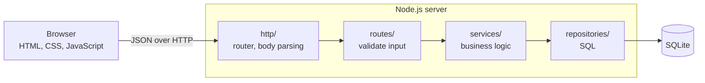

<p align="center">
  <picture>
    <source media="(prefers-color-scheme: dark)" srcset="docs/media/xaeo-wordmark-white.png">
    
  </picture>
</p>

<p align="center">
  <strong>See how your clients show up in AI answers, and fix it.</strong>
</p>

<p align="center">
  <a href="https://github.com/avdyanov24/xaeo-app/actions/workflows/ci.yml"></a>
  
  <a href="LICENSE"></a>
  <a href="https://prettier.io"></a>
  <a href="https://www.conventionalcommits.org"></a>
</p>

Xaeo is a web app for SEO and marketing agencies. When a potential customer asks ChatGPT or Claude "who is the best plumber in Leeds?", some businesses get recommended and others are never mentioned. Xaeo asks those buyer questions for each of an agency's clients, records who gets recommended and which pages are cited, and turns the gaps into prioritised fixes. Xo, the built-in assistant, drafts each fix for a person on the agency team to review and approve, and the results go into white-label reports the agency sends to its client.

<!-- Screenshots and a short screen recording go here once the web app runs end to end. -->

## Contents

- [Project status](#project-status)
- [Architecture](#architecture)
- [Getting started](#getting-started)
- [Scripts](#scripts)
- [Configuration](#configuration)
- [Testing](#testing)
- [Project structure](#project-structure)
- [Documentation](#documentation)
- [Contributing](#contributing)
- [Authors](#authors)
- [License](#license)

## Project status

Xaeo is under active development. This list tracks what is in `main`:

- [x] HTTP server with routing, input validation, a consistent JSON error format and a health check
- [x] CI: lint, formatting, tests on Node.js 22 and 24, Docker image build and smoke test
- [x] Static file server and the agency web app shell (pages, scripts, design tokens, fonts)
- [ ] Database layer and accounts (sign up, log in, sessions, user and admin roles)
- [ ] Agency web app: clients, buyer questions, scans and answers
- [ ] Fixes, approvals and the Xo assistant
- [ ] White-label client reports
- [ ] Account, team and admin pages

## Architecture



One request flows one way: the router matches the path, a route validates input and calls a service, the service applies the business rules, and only repositories run SQL. Errors become one JSON shape, `{ "error": { "code", "message" } }`, at the edge. Details in [docs/architecture.md](docs/architecture.md); the reasons for these choices are in [ADR 0001](docs/adr/0001-plain-node-layered-architecture.md).

**Tech stack:** Node.js (ES modules, no framework, no build step), `node:sqlite`, `node:test`, ESLint, Prettier, Docker, GitHub Actions.

## Getting started

Requirements: Node.js 22.13 or newer (`nvm use` picks the version in `.nvmrc`).

```sh
git clone https://github.com/avdyanov24/xaeo-app.git
cd xaeo-app
npm ci
cp .env.example .env
npm run dev
```

The server listens on <http://127.0.0.1:3000>. Check it with:

```sh
curl http://127.0.0.1:3000/api/health
```

The web app is at <http://127.0.0.1:3000/app>.

### With Docker

```sh
docker compose up --build
```

The container runs as a non-root user and reports its health through `/api/health`.

## Scripts

| Command                 | What it does                                        |
| ----------------------- | --------------------------------------------------- |
| `npm start`             | Start the server (reads `.env` when present)        |
| `npm run dev`           | Start the server and restart it when files change   |
| `npm test`              | Run unit and integration tests with `node --test`   |
| `npm run test:coverage` | Run the tests with a coverage report                |
| `npm run lint`          | Lint with ESLint (`lint:fix` applies safe fixes)    |
| `npm run format`        | Format with Prettier (`format:check` only checks)   |
| `npm run check`         | Lint, format check and tests: the same checks as CI |

## Configuration

Configuration comes from environment variables, validated at start-up; the server refuses to start and lists every invalid value. Copy `.env.example` to `.env` for local development.

| Variable    | Default       | Description                                       |
| ----------- | ------------- | ------------------------------------------------- |
| `NODE_ENV`  | `development` | `development`, `test` or `production`             |
| `HOST`      | `127.0.0.1`   | Interface to bind (`0.0.0.0` in the Docker image) |
| `PORT`      | `3000`        | Port to listen on                                 |
| `LOG_LEVEL` | `info`        | `debug`, `info`, `warn`, `error` or `silent`      |

## Testing

```sh
npm test
```

Tests use the built-in Node.js test runner. Unit tests in `tests/unit` cover single modules; integration tests in `tests/integration` start the real HTTP server on a random port and call it. CI runs the suite on Node.js 22 and 24 for every pull request.

## Project structure

```
.
├── .github/              CI workflow, Dependabot, issue and pull request templates
├── docs/
│   ├── adr/              architecture decision records
│   ├── api.md            HTTP API reference
│   └── architecture.md   how the server is organised
├── src/
│   ├── web/              the browser UI: app.html, ui/js, design tokens, fonts, assets
│   └── server/
│       ├── http/         router, JSON body parsing, response helpers, static files
│       ├── routes/       HTTP handlers, one module per area
│       ├── services/     business logic
│       ├── repositories/ SQL access
│       ├── lib/          errors, logger, validation
│       ├── app.js        builds the request handler
│       ├── config.js     environment configuration
│       └── index.js      process entry point
├── tests/
│   ├── unit/
│   ├── integration/
│   └── helpers/
├── Dockerfile
└── compose.yaml
```

## Documentation

- [Architecture](docs/architecture.md)
- [HTTP API reference](docs/api.md)
- [Architecture decision records](docs/adr/README.md)
- [Changelog](CHANGELOG.md)

## Contributing

Read [CONTRIBUTING.md](CONTRIBUTING.md) for the branch, commit and review workflow. Everyone taking part agrees to the [code of conduct](CODE_OF_CONDUCT.md). Report security issues privately as described in [SECURITY.md](SECURITY.md).

## Authors

- **Aleksandar Dyanov**, co-founder and CEO ([@avdyanov24](https://github.com/avdyanov24))
- **Velin Markov**, co-founder and CTO ([@VVMarkov24](https://github.com/VVMarkov24))

## License

Copyright (C) 2026 The Xaeo team. Released under the GNU General Public License v3.0 only; see [LICENSE](LICENSE).
